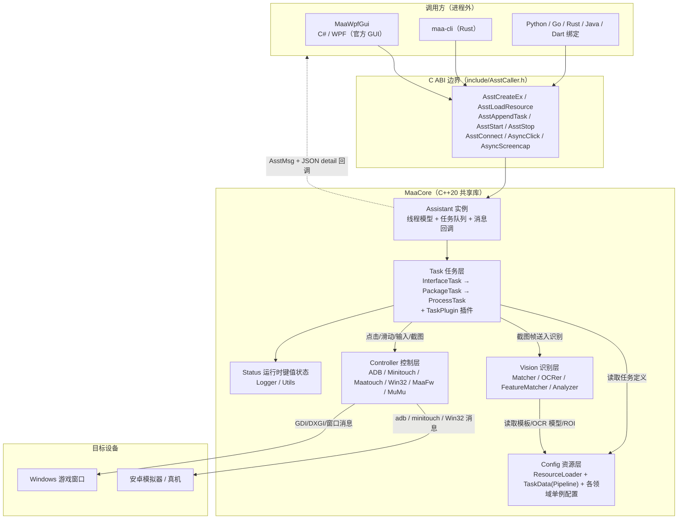
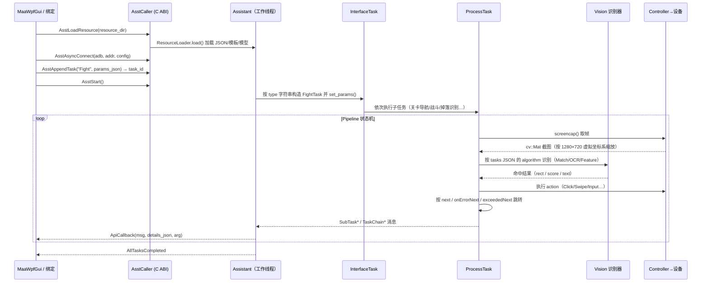
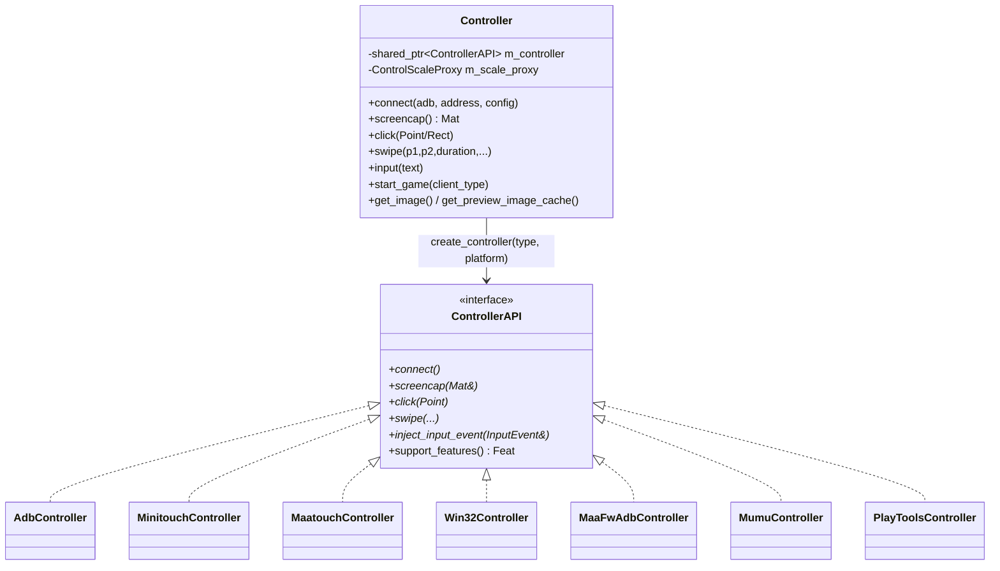
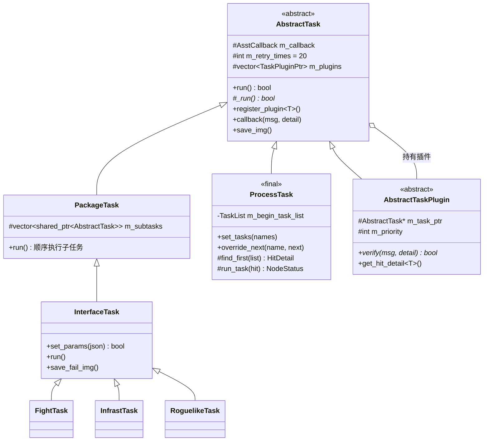
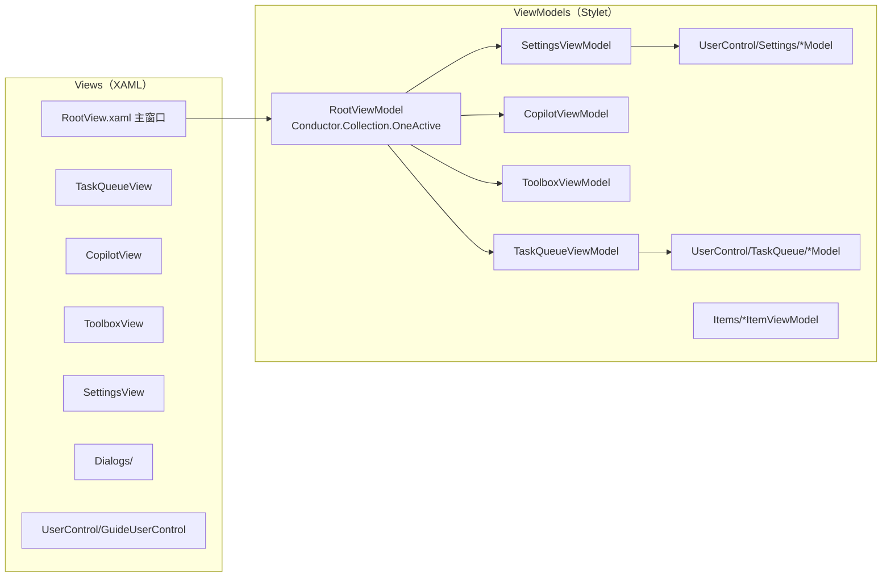
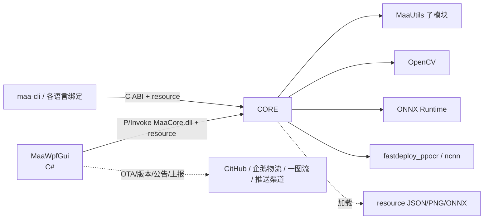

# MaaAssistantArknights Code Wiki

> 本文档是对 MAA（MaaAssistantArknights）仓库的结构化代码百科，覆盖项目整体架构、模块职责、关键类与函数、模块依赖关系，以及构建、运行与测试方式。
>
- 仓库地址：<https://github.com/MaaAssistantArknights/MaaAssistantArknights>
- 主开发分支：`dev-v2`
- 许可证：AGPL-3.0
- 本文基于仓库当前源码整理，路径均相对仓库根目录。

---

## 目录

1. [项目概览](#1-项目概览)
2. [仓库目录结构](#2-仓库目录结构)
3. [系统总体架构](#3-系统总体架构)
4. [MaaCore：C++ 核心库](#4-maacorec-核心库)
5. [Pipeline 任务流程协议](#5-pipeline-任务流程协议)
6. [resource 资源体系](#6-resource-资源体系)
7. [MaaWpfGui：WPF 图形界面](#7-maawpfguiwpf-图形界面)
8. [公共 C API 与多语言绑定](#8-公共-c-api-与多语言绑定)
9. [外围进程与工具](#9-外围进程与工具)
10. [依赖关系总览](#10-依赖关系总览)
11. [构建、运行与测试](#11-构建运行与测试)
12. [CI 与发布流水线](#12-ci-与发布流水线)
13. [关键文档与协议索引](#13-关键文档与协议索引)
14. [开发约定速查](#14-开发约定速查)

---

## 1. 项目概览

MAA 是一款基于 **图像识别** 的《明日方舟》游戏自动化助手，通过对游戏画面截图、识别 UI 元素（模板匹配 / OCR / 特征点匹配 / ONNX 神经网络），再向设备下发点击、滑动、输入等操作，实现 ｢ 唤醒游戏 → 刷关卡 → 基建换班 → 公招 → 收信用 → 肉鸽探索 ｣ 等全日常无人值守。

### 技术栈

| 层 | 技术 | 说明 | --- | --- | --- |
| 核心引擎 | C++20 / CMake 3.28+ | 产物为动态库 `MaaCore.dll` / `libMaaCore.so` / `libMaaCore.dylib` |
| 官方 GUI（Windows） | C# / .NET 10 / WPF | 程序集名 `MAA.exe`，MVVM 框架 Stylet，UI 库 HandyControl |
| 图像与模型 | OpenCV、ONNX Runtime、PaddleOCR（fastdeploy_ppocr）、ncnn（Android） | 模板匹配、文字识别、目标检测/分类 |
| 跨平台 CLI | Rust（子模块 maa-cli） | 面向 Linux / macOS / Windows 无头环境 |
| 其他 GUI | Swift（MaaMacGui 子模块）、Avalonia（MAAUnified 子模块） | 社区/官方跨平台界面 |
| 集成绑定 | C ABI、Python（ctypes）、Golang、Rust、Java、Dart | 均封装同一个 `AsstCaller.h` C 接口 |

### 支持平台与客户端

- **平台**：Windows、Linux、macOS、Android（核心库可交叉编译）。
- **游戏客户端**：官服 `Official`、B 服 `Bilibili`、繁中服 `txwy`、国际服 `YoStarEN`、日服 `YoStarJP`、韩服 `YoStarKR`，对应资源在 `resource/global/<客户端>/`。

---

## 2. 仓库目录结构

```
MaaAssistantArknights/
├── include/                  # MaaCore 对外公共头文件（稳定 C ABI）
│   ├── AsstCaller.h          #   主接口：AsstCreate/AppendTask/Start/回调 等
│   ├── AsstCallerExtra.h     #   额外接口
│   ├── AsstPort.h            #   跨平台导出宏（ASSTAPI/ASST_CALL）
│   └── MaaCore.h
├── src/
│   ├── MaaCore/              # C++ 核心库（本仓库主体，约 600+ 源文件）
│   ├── MaaWpfGui/            # C# WPF 官方 GUI
│   ├── MaaUpdater/           # MAA.Updater.exe：退出后应用更新包
│   ├── MaaAppHostStub/       # 启动宿主/崩溃提示占位程序
│   ├── MaaWineBridge/        # Linux Wine 下运行 Windows 版的兼容桥
│   ├── Cpp/                  # 最小 C++ 示例 / Debug Demo / Smoke Test
│   ├── Python/               # Python ctypes 绑定 + 示例 + 测试
│   ├── Golang/               # Go 绑定与 HTTP Server 示例
│   ├── Rust/                 # Rust 绑定与 HTTP Server 示例
│   ├── Java/                 # Java/Gradle 绑定工程
│   ├── Dart/                 # Dart/Flutter FFI 插件
│   ├── Woolang/              # 沃语言演示绑定
│   ├── MaaUtils/             # 子模块：通用 C++ 工具库 + MaaDeps 依赖
│   ├── maa-cli/              # 子模块：官方跨平台 CLI（Rust）
│   ├── MaaMacGui/            # 子模块：macOS 原生 GUI（Swift）
│   └── MAAUnified/           # 子模块：Avalonia 跨平台 GUI
├── resource/                 # 全部识别资源（JSON 任务流、模板图、OCR/ONNX 模型）
│   ├── tasks/                #   国服 Pipeline 任务流（v5.15.4 起为目录拆分）
│   ├── template/             #   模板匹配图片
│   ├── PaddleOCR/ PaddleCharOCR/  # OCR 模型
│   ├── onnx/                 #   ONNX 模型
│   ├── global/               #   外服增量资源（YoStarEN/JP/KR、txwy）
│   ├── roguelike/ custom_infrast/ copilot/ Arknights-Tile-Pos/
│   └── config.json 等全局配置
├── tools/                    # 开发/资源制作/发布辅助脚本（Python、C++、PowerShell）
├── docs/                     # VuePress 文档站（五语言：zh-cn/zh-tw/en-us/ja-jp/ko-kr）
├── cmake/                    # CMake 辅助脚本
├── 3rdparty/                 # 头文件型第三方库 + EmulatorExtras 子模块
├── test/                     # 子模块 MaaTestSet：识别回归测试图集
├── CMakeLists.txt            # 顶层 CMake
├── CMakePresets.json         # 各平台/发布预设
└── interface.json            # 对外接口元数据
```

---

## 3. 系统总体架构

### 3.1 分层视图

MAA 是典型的 **｢ 资源数据驱动的识别—决策—执行 ｣ 闭环引擎**，核心库与界面之间以纯 C ABI 解耦。



### 3.2 一次任务的运行时数据流



### 3.3 三个核心抽象

| 抽象 | 角色 | 关键类型 |
| --- | --- | --- |
| **Controller** | 与设备交互：截图、点击、滑动、输入、启停游戏 | `asst::Controller`、`ControllerAPI` |
| **Task** | 业务逻辑：在合适的时机识别并决策动作 | `AbstractTask`、`InterfaceTask`、`ProcessTask`、`AbstractTaskPlugin` |
| **Vision** | 画面理解：模板匹配、OCR、特征匹配、神经网络分类/检测 | `VisionHelper`、`Matcher`、`OCRer`、`FeatureMatcher` |

三者通过 `Assistant` 实例装配，通过 `InstHelper` 让任意 Task/Vision 对象能反向访问 `Controller`、`Status` 与 `Assistant`。

---

## 4. MaaCore：C++ 核心库

源码根目录 [src/MaaCore](file:///workspace/src/MaaCore)，由 [CMakeLists.txt](file:///workspace/src/MaaCore/CMakeLists.txt) 用 `file(GLOB_RECURSE)` 自动收集，**新增 .h/.cpp 无需登记 CMake**。产物 `MaaCore` 为 `SHARED` 库。

### 4.1 目录职责

| 目录 | 职责 |
| --- | --- |
| `Common/` | 公共类型：`AsstTypes.h`（Rect/Point/TaskInfo 等）、`AsstMsg.h`（回调消息枚举与回调签名）、`AsstBattleDef.h`（战斗数据结构）、`AsstInfrastDef.h`（基建结构） |
| `Config/` | 资源加载与配置：`ResourceLoader`、`TaskData`（Pipeline 编译）、`GeneralConfig`、`TemplResource`、`OnnxSessions`、`GpuDeviceSelector`；子目录 `TaskData/`（任务符号/语法树）、`Miscellaneous/`（战斗、公招、基建、物品、Tile、OCR 等领域配置）、`Roguelike/`（各肉鸽主题配置） |
| `Controller/` | 设备控制层与多后端实现、平台 IO（`Platform/Win32IO`、`PosixIO`、`AdbLiteIO`）、`adb-lite/`（自研轻量 adb 协议客户端） |
| `Task/` | 全部业务任务。`Interface/` 对外任务、`Fight/`、`Infrast/`、`Roguelike/`、`SSS/`、`Reclamation/`、`Miscellaneous/`、`MiniGame/`、`OperProgress/`、`Experiment/` |
| `Vision/` | 识别算法基类与各业务分析器：`Matcher`/`OCRer`/`FeatureMatcher` 等，子目录按 `Battle/Infrast/Oper/Roguelike/Miscellaneous/Config` 划分 |
| `Ui/` | 游戏内编队、助战列表等 UI 辅助逻辑 |
| `Utils/` | `Logger.hpp`、`Algorithm.hpp`、`BipartiteMatch.hpp`（二分图匹配）、`MinCostFlow.hpp`（最小费用流，用于基建排班）、字符串/JSON/平台工具 |
| 根目录 | `Assistant.cpp/.h`（实例）、`AsstCaller.cpp`/`AsstCallerExtra.cpp`（C ABI 导出）、`InstHelper`、`Status` |

### 4.2 Assistant：实例、线程与任务队列

[Assistant.h](file:///workspace/src/MaaCore/Assistant.h) / [Assistant.cpp](file:///workspace/src/MaaCore/Assistant.cpp) 是核心库的门面，继承抽象接口 `AsstExtAPI`。

- **多实例**：每次 `AsstCreateEx(callback, arg)` 创建一个独立 `Assistant`，各自持有 `Controller`、`Status` 与任务队列；`TaskId` / `AsyncCallId` 为进程级自增。
- **三条内部线程**：
  - `working_proc()`：串行执行任务队列 `m_tasks_list`（`std::list<pair<TaskId, InterfaceTask>>`）；
  - `msg_proc()`：从 `m_msg_queue` 取消息，经 `ApiCallback` 回调到外部（C# / Python 等）；
  - `call_proc()`：串行执行异步调用队列（连接 / 点击 / 截图 / Win32 绑定窗口），支持 `block` 等待与完成号 `m_completed_call`。
- **任务工厂（X-Macro）**：[Assistant.cpp](file:///workspace/src/MaaCore/Assistant.cpp#L303-L351) 的 `append_task(type, params)` 用宏展开把字符串类型映射到具体类：
  `Fight / StartUp / CloseDown / Award / Mall / Infrast / OperProgress / Recruit / Roguelike / Copilot / SSSCopilot / ParadoxCopilot / SingleStep / VideoRecognition / Depot / OperBox / Reclamation / SwitchTheme / Custom`（Debug 构建额外有 `Debug`）。解析 params JSON 后调用 `ptr->set_params(json)`。
- **关键方法**：`set_instance_option()`（触控模式 / 部署暂停 / 客户端类型 / 代理等）、`async_connect()`、`async_click()`、`async_screencap()`、`start()`、`stop()`、`back_to_home()`、`get_image()`、`get_uuid()`。

进程级初始化（在 C ABI 层）：`AsstSetUserDir()`（日志/调试图/缓存目录）、`AsstLoadResource()`（触发 `ResourceLoader::load()`）、`AsstSetStaticOption()`。

### 4.3 回调消息体系

[AsstMsg.h](file:///workspace/src/MaaCore/Common/AsstMsg.h) 定义消息枚举，全部以 JSON 字符串承载 detail：

| 段位 | 消息 |
| --- | --- |
| 0 全局 | `InternalError`、`InitFailed`、`ConnectionInfo`、`AllTasksCompleted`、`AsyncCallInfo`、`Destroyed` |
| 10000 任务链 | `TaskChainError/Start/Completed/ExtraInfo/Stopped` |
| 20000 子任务 | `SubTaskError/Start/Completed/ExtraInfo/Stopped` |
| 30000 网络 | `ReportRequest`（掉落/公招上报企鹅物流、一图流） |

回调签名：内部 `std::function<void(AsstMsg, json::value, Assistant*)>`；对外 `void (*)(int msg, const char* details_json, void* arg)`。字段含义见 [callback-schema.md](file:///workspace/docs/zh-cn/protocol/callback-schema.md)。

### 4.4 Controller 设备控制层



- [Controller.h](file:///workspace/src/MaaCore/Controller/Controller.h)：对外门面，持有具体后端与 [ControlScaleProxy.h](file:///workspace/src/MaaCore/Controller/ControlScaleProxy.h)。**所有坐标以 1280×720 虚拟分辨率为基准**，由缩放代理映射到真机分辨率；截图缓存以 `shared_mutex` 保护（`m_cache_image` / `m_preview_image`）。
- [ControllerAPI.h](file:///workspace/src/MaaCore/Controller/ControllerAPI.h)：后端抽象接口，定义截图、点击、滑动、`inject_input_event`（统一触控/按键事件注入）、`support_features()` 能力查询；并定义 `ControllerType`（`Adb / Minitouch / Maatouch / MacPlayTools / Win32 / MaaFwAdb / Mumu / MaaFwAndroidNative`）。
- 主要后端：
  - [AdbController](file:///workspace/src/MaaCore/Controller/AdbController.cpp)：纯 adb 命令（screencap/input），兼容性最好；
  - [MinitouchController](file:///workspace/src/MaaCore/Controller/MinitouchController.cpp) / `MaatouchController.h`：向设备推送触控程序，手势更平滑；
  - [Win32Controller](file:///workspace/src/MaaCore/Controller/Win32Controller.cpp)：Windows 模拟器窗口，截图可选 GDI / DXGI Desktop Duplication / PrintWindow / ScreenDC，输入可选 SendMessage / PostMessage / Seize 等（枚举见 [AsstCaller.h](file:///workspace/include/AsstCaller.h#L11-L38)）；
  - `MaaFwAdbController` / `MaaFwAndroidNativeController`：复用 MaaFramework 控制单元（`MaaFwControlUnitInterface`）；
  - `MumuController` + `MumuExtras`、`LDExtras`：模拟器厂商增强通道（需 `WITH_EMULATOR_EXTRAS`，依赖 `3rdparty/EmulatorExtras` 子模块）；
  - `PlayToolsController` + `MacSCKHelper.mm`：macOS 端 PlayTools 与 ScreenCaptureKit（`WITH_MAC_SCK`）。
- 平台 IO：`Platform/` 下按系统拆分进程/管道操作（Win32 / POSIX），`AdbLiteIO` + `adb-lite/` 是自研的轻量 adb 协议实现（不依赖系统 adb 可直连设备）。
- 连接配置（各模拟器的 adb 路径、地址、触控方式、启停游戏命令等）集中在 `resource/config.json`，由 `GeneralConfig` 解析；GUI 的模拟器额外参数经 `AsstSetConnectionExtras` 注入。

### 4.5 Task 任务体系

#### 4.5.1 类层次



- **[AbstractTask](file:///workspace/src/MaaCore/Task/AbstractTask.h)**：所有任务基类。模板方法 `run()` 包重试（默认 `RetryTimesDefault = 20`）、`enable` / `ignore_error`、插件注册（`register_plugin<T>()`、`find_plugin<T>()`）、回调与调试截图；子类实现纯虚 `_run()`。
- **[PackageTask](file:///workspace/src/MaaCore/Task/PackageTask.h)**：顺序执行 `m_subtasks` 的组合任务，并向下传播重试次数与 task id。
- **[InterfaceTask](file:///workspace/src/MaaCore/Task/InterfaceTask.h)**：对外可 `append_task` 的任务链基类，重写 `set_params(json)`，失败时 `save_fail_img()` 保存现场。
- **[ProcessTask](file:///workspace/src/MaaCore/Task/ProcessTask.h)**（`final`）：**Pipeline 引擎本体**。它不写死业务，而是接收一组任务名（`set_tasks()`），在 [resource/tasks](file:///workspace/resource/tasks) 的 JSON 图上跑 ｢ 识别 → 动作 → 跳转 ｣ 状态机：
  - `find_first(list)`：在候选任务里取第一个识别命中的 `HitDetail`（含截图、rect、识别结果、TaskInfo 指针）；
  - `run_task()`：按命中任务的 `action` 执行（`exec_click_task` / `exec_swipe_task` / `exec_input_task`），返回 `NodeStatus`（`Success / RetryFailed / Runout / Interrupted / InternalError`）；
  - 跳转依据 `next` / `onErrorNext` / `exceededNext`，并受 `maxTimes`、`preDelay/postDelay`、`reduceOtherTimes` 等约束；
  - `override_next()` / `set_times_limit()` / `set_post_delay()` 供 C++ 侧在运行时动态改写 JSON 流程。
- **[AbstractTaskPlugin](file:///workspace/src/MaaCore/Task/AbstractTaskPlugin.h)**：插件基类，挂在某个 ProcessTask 上，通过 `verify(msg, detail)` 订阅子任务回调消息，按 `priority` 排序、`block` 控制是否阻塞主流程；用 `get_hit_detail<T>()` 取回识别结果。典型用途：战斗任务统计次数、识别掉落物、碎石/吃药、肉鸽各决策环节。

#### 4.5.2 业务任务组织（src/MaaCore/Task）

| 子目录 / 文件 | 代表任务 | 说明 |
| --- | --- | --- |
| `Interface/` | `FightTask`、`StartUpTask`、`CloseDownTask`、`AwardTask`、`MallTask`、`InfrastTask`、`RecruitTask`、`RoguelikeTask`、`CopilotTask`、`SSSCopilotTask`、`ParadoxCopilotTask`、`DepotTask`、`OperBoxTask`、`OperProgressTask`、`ReclamationTask`、`SwitchThemeTask`、`CustomTask`、`SingleStepTask`、`VideoRecognitionTask` | 对外任务类型，每个定义 `inline static constexpr std::string_view TaskType`，与 `Assistant::append_task` 一一对应 |
| `Fight/` | `StageNavigationTask`、`StageDropsTaskPlugin`、`FightTimesTaskPlugin`、`MedicineCounterTaskPlugin`、`DrGrandetTaskPlugin`、`SideStoryReopenTask` | 关卡导航、掉落识别、次数/药剂/源石、活动复刻 |
| `Infrast/` | `InfrastControlTask`、`InfrastMfgTask`、`InfrastTradeTask`、`InfrastPowerTask`、`InfrastDormTask`、`InfrastOfficeTask`、`InfrastReceptionTask`、`InfrastTrainingTask`、`InfrastProductionTask`、`InfrastScore`、`DronesForShamareTaskPlugin` 等 | 基建换班；`InfrastScore` + 通用最小费用流做干员效率最优化，支持自定义排班 JSON |
| `Roguelike/` | `AbstractRoguelikeTaskPlugin` 及 20+ 插件：`Recruit`、`Battle`、`Shopping`、`Invest`、`Formation`、`DifficultySelection`、`CustomStart`、`Settlement`、`IterateMonthlySquad/DeepExploration`、`StageEncounter`、`StrategyChange` 等 | 集成战略（肉鸽）全自动；主题 Phantom/Mizuki/Sami/Sarkaz/JieGarden/BlackFlow |
| `SSS/` | `SSSBattleProcessTask`、`SSSStageManagerTask`、`SSSDropRewardsTaskPlugin` | 保全派驻 |
| `Reclamation/` | `AbstractReclamationTaskPlugin`、`ReclamationConfig`、`ReclamationCraftTaskPlugin` | 生息演算 |
| `Miscellaneous/` | `AutoRecruitTask`、`CreditShoppingTask`、`CreditFightTask`、`BattleProcessTask`、`BattleFormationTask`、`DepotRecognitionTask`、`OperBoxRecognitionTask`、`StartGameTaskPlugin`、`ScreenshotTaskPlugin` | 公招、信用、通用战斗仿真（抄作业）、仓库/干员识别 |
| `MiniGame/` | `MaterialSynthesisTaskPlugin`、`EventShopTaskPlugin`、`SecretFrontTaskPlugin`、`PixelPaintTaskPlugin`、`AutoRaisePotentialTaskPlugin` | 活动小游戏 |
| `OperProgress/`、`Experiment/` | `OperProgressProcessTask`、`SingleStepBattleProcessTask`、`CombatRecordRecognitionTask` | 干员练度识别；实验性战斗复盘识别 |

`BattleHelper` / `StageNavigationHelper.h` 是战斗与关卡导航的共享辅助。以 `FightTask` 为例，其构造时装配 `StageNavigationTask` + 战斗 `ProcessTask`，并注册战斗次数、药剂、掉落、｢ 大爹 ｣ 等插件（见 [FightTask.h](file:///workspace/src/MaaCore/Task/Interface/FightTask.h)）。

### 4.6 Vision 视觉识别层

[VisionHelper.h](file:///workspace/src/MaaCore/Vision/VisionHelper.h) 是识别器基类：持有截图 `m_image`、感兴趣区域 `m_roi`、`ASST_DEBUG` 下的调试图 `m_image_draw`；提供 ROI 裁剪、mask 生成、ROI 框绘制、结果排序（横/纵/分数/指定顺序）、NMS 非极大值抑制等工具。坐标统一以 `correct_rect` 校正。

**算法基类**（均为 ｢ Helper + Config ｣ 多继承，参数来自 TaskInfo）：

| 类 | 文件 | 能力 |
| --- | --- | --- |
| `Matcher` | [Matcher.h](file:///workspace/src/MaaCore/Vision/Matcher.h) | 单目标模板匹配（`cv::TM_CCOEFF_NORMED`），`preproc_and_match()` 支持 OpenCV/优化实现与颜色计数（RGB/HSV），结果 `MatchRect` |
| `MultiMatcher` | `MultiMatcher.h` | 多目标模板匹配 |
| `BestMatcher` | `BestMatcher.h` | 多模板择优匹配（基建干员/技能图标等） |
| `MaskedCcoeffMatcher` | `MaskedCcoeffMatcher.h` | 带掩码相关系数匹配 |
| `OCRer` | [OCRer.h](file:///workspace/src/MaaCore/Vision/OCRer.h) | 文字检测+识别（PaddleOCR），支持 required 过滤、`ocrReplace` 正则替换、二值化前/后处理 |
| `RegionOCRer` / `TemplDetOCRer` | 同名文件 | 先定区域再 OCR / 先模板定位再 OCR（带缓存） |
| `FeatureMatcher` | `FeatureMatcher.h` | 特征点匹配（加载失败/无固定模板的 UI） |
| `OnnxHelper` | `OnnxHelper.h` | ONNX Runtime 推理封装；`Config/OnnxSessions` 管理 `skill_ready_cls`（技能开启分类）、`deploy_direction_cls`（部署方向分类）、`operators_det`（干员检测）等会话 |

**业务分析器**（组合上述算法输出领域结果），按目录划分：

- `Battle/`：`BattlefieldMatcher`（敌方/我方单位匹配）、`BattlefieldClassifier`（技能/朝向分类）、`BattlefieldDetector`（ONNX 干员检测）、`BattleFormationAnalyzer`、`SupportListAnalyzer`（助战列表）；
- `Infrast/`：`InfrastFacilityImageAnalyzer`（设施检测）、`InfrastOperImageAnalyzer`（干员状态/心情/技能）、`InfrastClueVacancyImageAnalyzer`、`InfrastSmileyImageAnalyzer`；
- `Oper/`：`OperBoxImageAnalyzer`（干员 box）、`OperFilesImageAnalyzer`、`OperNameAnalyzer`；
- `Roguelike/`：`RoguelikeRecruitImageAnalyzer`、`RoguelikeFormationImageAnalyzer`、`RoguelikeSkillSelectionImageAnalyzer`、`RoguelikeEncounterOptionAnalyzer`、`RoguelikeParameterAnalyzer`、`RoguelikeRecruitSupportAnalyzer`；
- `Miscellaneous/`：`RecruitImageAnalyzer`（公招标签）、`CreditShopImageAnalyzer`、`DepotImageAnalyzer`（仓库材料）、`StageDropsImageAnalyzer`（关卡掉落）、`MaterialSynthesisImageAnalyzer`、`PixelAnalyzer`、`PipelineAnalyzer`；
- `Hasher`：图像哈希（缓存/去重）。

### 4.7 Config 资源层与单例体系

- [AbstractResource.h](file:///workspace/src/MaaCore/Config/AbstractResource.h) / [AbstractConfig.h](file:///workspace/src/MaaCore/Config/AbstractConfig.h)：资源加载基类（`load(path)`）；`AbstractConfigWithTempl` 额外声明所需模板（`get_templ_required()`），由 `TemplResource` 懒加载对应 PNG。
- 所有配置类通过 `MAA_NS::SingletonHolder<T>` 以单例访问（如 `TaskData::get_instance()`），并用 meojson 反序列化。
- [ResourceLoader](file:///workspace/src/MaaCore/Config/ResourceLoader.cpp) 是加载总控（自身单例），`load(path)` 严格按顺序加载并支持 `xxx_custom.json` 用户覆盖：
  1. ONNX 会话（3 个模型，惰性）；
  2. PaddleOCR / PaddleCharOCR 模型；
  3. 核心 JSON：`config.json`（GeneralConfig）、`recruitment.json`、`battle_data.json`、`ocr_config.json`；
  4. 头像缓存（依赖 BattleDataConfig）；
  5. **Pipeline：`resource/tasks/` 目录（新）或废弃的 `tasks.json`（旧，v5.15.4 前）**，同时加载 `template/`；
  6. `infrast.json`、`item_index.json`、`stages.json`、`Arknights-Tile-Pos/overview.json`（地图格子数据）；
  7. 六大肉鸽主题的 autopilot/recruitment/shopping/encounter/map 及 Sami/JieGarden/BlackFlow 专属配置。
- [TaskData](file:///workspace/src/MaaCore/Config/TaskData.h)：Pipeline 数据核心。`load()` 后做 **编译**：处理 `baseTask` 继承、`@` 特殊任务、`#self/#next/#back` 引用、前缀展开（`TaskData/TaskDataSymbol*` 实现符号化引用与编译期校验），产出 `TaskInfo` 派生对象（`MatchTaskInfo / OcrTaskInfo / FeatureMatchTaskInfo` 等）。运行期 `ProcessTask` 通过 `TaskData::get(name)` 取任务定义；`ASST_DEBUG` 下加载期执行 `syntax_check()`（字段白名单校验，Release 静默）。
- [GeneralConfig](file:///workspace/src/MaaCore/Config/GeneralConfig.h)：解析 `config.json`（全局延迟、滑动参数、上报 URL、模拟器连接配置 `device.json` 风格的配置项），并维护 `set_connection_extras()` 差异覆盖。
- 领域配置（`Config/Miscellaneous/`）：`BattleDataConfig`（敌人/干员数据）、`CopilotConfig` / `SSSCopilotConfig`（作业 JSON）、`InfrastConfig`（基建设施/技能）、`RecruitConfig`（公招标签与稀有度）、`ItemConfig`（物品 id↔名称↔图标）、`StageDropsConfig`（关卡与掉落）、`TilePack`（地图格子几何）、`OcrConfig`、`OperBoxDataConfig`、`AvatarCacheManager`；`Config/Roguelike/` 下为肉鸽各主题配置。

### 4.8 Status、InstHelper 与 Utils

- [Status](file:///workspace/src/MaaCore/Status.h)：实例级运行时键值存储，分 `number / rect / string / properties` 四类；`string` 在跨任务时清理，`properties` 保留。ProcessTask 用 `#LastTime#` 前缀记录上次执行时间等。
- [InstHelper](file:///workspace/src/MaaCore/InstHelper.h)：混入式助手，让 Task/Vision 子类用 `ctrler()`、`status()`、`inst()`、`need_exit()` 直接访问所属实例。
- `Utils/Logger.hpp`：流式日志 `LogDebug/LogTrace/LogInfo/LogWarn/LogError`，正文要求英文，输出到 `debug/asst.log`。
- `Utils/`：`BipartiteMatch.hpp`、`MinCostFlow.hpp`（基建最优化）、`Algorithm.hpp`、`StringMisc.hpp`、`JsonMisc.hpp`、`WorkingDir.hpp`（`UserDir` 全局路径）、`Platform.hpp`、`LibraryHolder`、`Demangle` 等。
- 路径与编码约定：字符串一律 UTF-8 `std::string`；文件路径经 `asst::utils::path()` 或 `"xxx"_p` 字面量构造，仅 Win32 API 边界转宽字符；错误处理用 `bool` / `std::optional` / 空指针，不用异常承载常规失败。

---

## 5. Pipeline 任务流程协议

Pipeline 是 MAA ｢ 数据驱动 ｣ 的核心：**业务流程不是硬编码的 if-else，而是 `resource/tasks/*.json` 中一张由任务名索引的有向图**，由 `ProcessTask` 解释执行。完整字段见 [task-schema.md](file:///workspace/docs/zh-cn/protocol/task-schema.md)，JSON Schema 见 [docs/maa_tasks_schema.json](file:///workspace/docs/maa_tasks_schema.json)。

### 5.1 一个任务节点的核心字段

```json
{
    "StartButton": {
        "baseTask": "某模板任务",
        "algorithm": "MatchTemplate",
        "action": "ClickSelf",
        "roi": [0, 0, 1280, 720],
        "template": "StartButton.png",
        "templThreshold": 0.8,
        "maskRange": [1, 255],
        "method": "Ccoeff",
        "text": ["开始行动"],
        "next": ["StageFight", "SanityNotEnough"],
        "onErrorNext": ["Return"],
        "exceededNext": [],
        "maxTimes": 10,
        "preDelay": 0,
        "postDelay": 500,
        "cache": false,
        "interrupt": ["PopupClose"]
    }
}
```

- **algorithm（识别算法）**：`JustReturn`（不识别直接执行）、`MatchTemplate`（默认）、`OcrDetect`、`FeatureMatch`。
- **action（命中动作）**：`DoNothing`（默认）、`ClickSelf`、`ClickRect`、`Swipe`、`Input`、`Stop`。
- **流程字段**：`next`（顺序匹配第一个命中者）、`onErrorNext`（重试耗尽）、`exceededNext`（超过 `maxTimes`）、`sub`（子任务，不推荐）、`reduceOtherTimes`、`interrupt`（可被打断任务抢占）。
- **特殊引用**：`#self`（自身）、`#back`（返回上一节点）、`#next`；`@` 前缀表示特殊/共享任务；`baseTask` 实现模板继承。
- **识别参数**：`roi`（1280×720 基准自动缩放）、`template/templThreshold/maskRange/colorScales/method/nmsDistance`（模板）、`text/ocrReplace/order_by`（OCR）、`specialParams`、`rectMove/specificRect`、`cache` 等。

### 5.2 文件组织

`resource/tasks/` 按业务拆分：`tasks.json`（基础流程/通用弹窗/主界面）、`Stages/*.json`（关卡导航）、`Roguelike/*.json`（肉鸽）、`Copilot/`、`MiniGame/`、`RA/`（生息演算）、`UiTheme/`（换肤）、`hotfix/ocr_replace.json`。外服在 `resource/global/<服>/resource/tasks/` 提供同名覆盖/增量。

`ProcessTask` 是唯一的 Pipeline 解释器；C++ 业务任务（如各类插件）只在需要复杂决策（识别掉落、算排班、肉鸽选技能）时介入，其余跳转全部交给 JSON。

---

## 6. resource 资源体系

| 路径 | 内容 |
| --- | --- |
| `resource/tasks/` | 国服 Pipeline 任务流 JSON（拆分目录） |
| `resource/template/` | 模板匹配 PNG，按 `Award/Gacha/WakeUp/StageNavigation/infrast/avatar/...` 组织；任务 JSON 中 `template` 字段递归搜索 |
| `resource/PaddleOCR/`、`PaddleCharOCR/` | PaddleOCR det+rec ONNX 模型与 `keys.txt` |
| `resource/onnx/` | `skill_ready_cls.onnx`、`deploy_direction_cls.onnx`、`operators_det.onnx`、`BlackFlow_corridor_net.onnx` |
| `resource/roguelike/<主题>/` | 肉鸽招募、购物、事件、地图、策略等 JSON |
| `resource/custom_infrast/` | 内置自定义基建排班方案（153/243/333 等） |
| `resource/copilot/` | 内置作业（如信用作战 OF-1） |
| `resource/Arknights-Tile-Pos/` | 全关卡地图格子坐标（`overview.json` + 每关 JSON） |
| `resource/global/<服>/resource/` | 外服差异：OCR 模型、tasks、template、item/recruit 配置 |
| `resource/config.json` | 全局运行参数（延迟、滑动、上报地址等）与 `_Doc` 注释字段 |
| `resource/version.json` | 资源版本，供 OTA 更新校验 |

每个核心 JSON 都支持同名 `_custom.json` 覆盖（如 `tasks_custom.json`），由 `ResourceLoader::load_with_custom` 合并，供高级用户自定义而不改动官方文件。

---

## 7. MaaWpfGui：WPF 图形界面

源码 [src/MaaWpfGui](file:///workspace/src/MaaWpfGui)，.NET 10、`net10.0-windows10.0.17763.0`、C# 14，支持 win-x64 / win-arm64；启动对象 `MaaWpfGui.App`，程序集输出名 `MAA.exe`（见 [MaaWpfGui.csproj](file:///workspace/src/MaaWpfGui/MaaWpfGui.csproj)）。MVVM 框架为 **Stylet**，UI 控件库 **HandyControl**，配置织入用 **PropertyChanged.Fody**。

### 7.1 启动生命周期

[App.xaml.cs](file:///workspace/src/MaaWpfGui/App.xaml.cs) 启动 Stylet 的 [Bootstrapper](file:///workspace/src/MaaWpfGui/Main/Bootstrapper.cs)（`Bootstrapper<RootViewModel>`），关键顺序（`OnStart`）：

1. 切工作目录到程序目录、建 `debug/`、初始化 Serilog（`debug/gui.log`）；
2. 解析早期命令行：`--skip-startup-auto-run`、`--keep-awake`、`--skip-core-init`（纯 UI 预览，跳过全部 native 调用）、`--demo/--shots`（README 自动截图演示模式）；
3. `ConfigurationHelper.Load()` + `LocalizationHelper.Load()`，消费上次更新结果、旧配置迁移 `ConfigConverter.ConvertConfig()`、ETag 缓存；
4. 启动环境校验：`MaaCore.dll` 存在性、`resource/` 目录、未知 DLL 劫持检测、VC++ 运行库探测、安装目录合法性、单实例 Mutex；
5. `ConfigureIoC()` 注册单例（各主 ViewModel、`AsstProxy`、`StageManager`、热键、通知、HTTP、远程控制等），`Configure()` 中 `Instances.Instantiate(Container)`；
6. `DisplayRootView()` 显示主窗口，启动实例激活/保活事件监听、成就追踪、完整性检查与更新检查。

退出 `OnExit` 时后台限时销毁 Core（避免与回调互锁）、释放热键/通知、保存配置、清理 `.old` 与 OTA 临时文件，并支持更新后重启。

### 7.2 MVVM 目录结构



- **View/VM 命名镜像**（Stylet 约定自动解析）：`XxxView` ↔ `XxxViewModel`；`XxxUserControl` ↔ `XxxUserControlModel`（类名以 Model 结尾）。
- [RootViewModel](file:///workspace/src/MaaWpfGui/ViewModels/UI/RootViewModel.cs)：`Conductor<Screen>.Collection.OneActive`，持有四个主页面；`OnViewLoaded` 中初始化各 VM 与 Core 代理、处理公告/版本/Nightly 提示。
- 主页面（[ViewModels/UI](file:///workspace/src/MaaWpfGui/ViewModels/UI)）：
  - `TaskQueueViewModel`：任务队列编排、启动/停止、日志输出、连接管理（GUI 最核心 VM）；
  - `CopilotViewModel`：自动抄作业（战斗/SSS），作业 JSON 编辑与视频识别；
  - `ToolboxViewModel`：仓库识别、干员 box、公招计算、信用、计时器等工具箱；
  - `SettingsViewModel`：设置聚合根，挂载 `ViewModels/UserControl/Settings/` 下 16 个设置分组模型（连接、启动、游戏、GUI、后台、计时器、性能、热键、外接通知、远程控制、第三方上报、版本更新、成就等）；
  - `OverlayViewModel`：游戏画面叠加层。
- 任务设置模型在 [ViewModels/UserControl/TaskQueue](file:///workspace/src/MaaWpfGui/ViewModels/UserControl/TaskQueue)（Fight/Infrast/Recruit/Roguelike/Mall/Award/Reclamation/SwitchTheme/Depot 等），与 Core 的任务类型一一对应；列表项在 `ViewModels/Items/` 与 `TaskItemViewModel`、`TaskSettingsViewModel`。
- [Instances](file:///workspace/src/MaaWpfGui/Helper/Instances.cs)：**静态服务定位器**，项目约定跨对象取用走 `Instances.Xxx` 而非构造注入；`Instances.Data` 存放本轮运行的易失数据（药剂使用次数等，队列开始时 `ClearCache()`）。
- 样式与资源：`Res/Styles/`（控件样式）、`Res/Themes/`（明暗）、`Res/Localizations/*.xaml`（五语言，全部用 `DynamicResource` 以支持热切换）、`Styles/Controls/`（含自定义 `controls:TextBlock`、`TooltipBlock`、`TreeComboBox` 等）。

### 7.3 与 MaaCore 的互操作

- [MaaService](file:///workspace/src/MaaWpfGui/Services/MaaService.cs)：`internal static partial class`，用 `[LibraryImport("MaaCore.dll")`（`LibraryImport`/`DisableRuntimeMarshalling` 风格）声明全部 C ABI：`AsstCreateEx/AsstDestroy/AsstLoadResource/AsstSetUserDir/AsstAsyncConnect/AsstAttachWindow/AsstAppendTask/AsstSetTaskParams/AsstStart/AsstStop/AsstAsyncScreencap/AsstGetImage/...`，回调委托 `CallbackDelegate(int msg, IntPtr json, IntPtr arg)`。
- [AsstProxy](file:///workspace/src/MaaWpfGui/Main/AsstProxy.cs)：MaaService 之上的**唯一业务封装层**（单例）。职责：
  - UTF-8 手动封送（`EncodeNullTerminatedUtf8`）、初始化（`AsstSetUserDir`/`AsstLoadResource`/静态选项/模拟器 extras）；
  - 把各任务设置模型序列化为 params JSON 并 `AsstAppendTask`，维护 task id↔任务对象；
  - 接收 Core 回调：按 [AsstSubTaskMsg](file:///workspace/src/MaaWpfGui/Models/AsstSubTaskMsg.cs) 分发，更新任务状态、向 `TaskQueueViewModel` / `CopilotViewModel` 写日志（`AddLog`）、转发截图帧、处理连接信息与 `AllTasksCompleted`；
  - 异步截图→`WriteableBitmap` 预览、Win32 窗口绑定、MuMu/雷电 extras 配置。
- GUI 任务参数模型在 [Models/AsstTasks](file:///workspace/src/MaaWpfGui/Models/AsstTasks)（`AsstBaseTask` 及 `AsstFightTask`/`AsstInfrastTask`/…），负责序列化成 Core 需要的 JSON；`BaseTask` 上用 `[JsonDerivedType(...)]` 做多态鉴别。

### 7.4 配置持久化

- [ConfigFactory](file:///workspace/src/MaaWpfGui/Configuration/Factory/ConfigFactory.cs)：配置总入口，文件 `config/gui.new.json`（带 `.bak` 备份）。基于 `System.Text.Json`，特点：
  - 全局配置 `ConfigFactory.Root`（类型 [Root](file:///workspace/src/MaaWpfGui/Configuration/Root.cs)）与当前档案 `ConfigFactory.CurrentConfig`（多账号/多套配置切换，`SpecificConfig`）；
  - **防抖自动保存**（200 ms Timer + 信号量），写入失败回退备份；
  - 一组迁移 `Converter`（容错枚举、旧字段重命名、设置页重组、通知设置迁移等）与 `JsonPredictSerializationModifier`；
  - `MaaWpfGui.Configuration.` 命名空间内使用纯 auto-property，由 Fody PropertyChanged 织入变更通知。
- 配置结构：`Configuration/Global/Gui.cs`、`Update.cs`、`Background.cs`、`Timer.cs`、`Performance.cs`、`AnnouncementInfo.cs`；读取设置统一走 `SettingsViewModel.XxxSettings.X`。

### 7.5 Services / Helper / States / Extensions

| 目录 | 关键类型 |
| --- | --- |
| `Services/Web/` | `HttpService`、`MaaApiService`（GitHub/官方 API）、`YituliuApiService`（一图流）、`GameDataReportService`（上报） |
| `Services/ExternalNotification/` | 10 种推送渠道 Provider：ServerChan、Bark、DingTalk、Discord、Telegram、Email(SMTP/MailKit)、Qmsg、Gotify、CustomWebhook；`ExternalNotificationService` 统一调度 |
| `Services/Notification/` | 本地通知服务、过滤、历史、触发器 |
| `Services/HotKeys/` | 全局热键注册（基于 GlobalHotKey） |
| `Services/RemoteControl/` | 远程控制（HTTP 接口，协议见 remote-control-schema） |
| `Services/` | `StageManager`（关卡/活动数据）、`ResourceIntegrityChecker`（资源完整性）、`PendingUpdateApplier`（更新包应用）、`PowerManagement` 相关 |
| `Helper/` | `Instances`、`LocalizationHelper`（五语言）、`ConfigurationHelper`、`EmulatorHelper`（模拟器检测）、`PathsHelper`、`GrowlHelper`/`MessageBoxHelper`、`RecruitTagHelper`、`CopilotHelper`、`DataHelper`/`JsonDataHelper`（企鹅数据）、`OperAvatarHelper`、`ThemeHelper`、`ToastNotification`、`WindowManager` 等 |
| `States/` | `RunningState`（运行/空闲/连接状态单例）、`RunControlState`（运行参数） |
| `WineCompat/` | Wine 下运行的桌面集成：libnotify、GdkPixbuf、fontconfig 等（与 MaaWineBridge 配合） |
| `Main/DemoShotMode/` | README 截图演示模式的数据与自动截图服务 |

---

## 8. 公共 C API 与多语言绑定

### 8.1 C ABI

公共头 [include/AsstCaller.h](file:///workspace/include/AsstCaller.h)（+ `AsstCallerExtra.h`），实现 [AsstCaller.cpp](file:///workspace/src/MaaCore/AsstCaller.cpp)，跨平台导出宏见 `AsstPort.h`。核心函数：

```c
AsstBool AsstSetUserDir(const char* path);
AsstBool AsstLoadResource(const char* path);
AsstHandle AsstCreateEx(AsstApiCallback callback, void* custom_arg);
void     AsstDestroy(AsstHandle handle);
AsstBool AsstSetInstanceOption(AsstHandle, AsstInstanceOptionKey, const char* value);
AsstAsyncCallId AsstAsyncConnect(handle, adb, address, config, block);   // Win32: AsstAsyncAttachWindow
AsstTaskId AsstAppendTask(handle, const char* type, const char* params);
AsstBool   AsstSetTaskParams(handle, id, params);
AsstBool AsstStart(handle);  AsstBool AsstStop(handle);
AsstBool AsstRunning(handle); AsstBool AsstConnected(handle);
AsstAsyncCallId AsstAsyncClick(handle, x, y, block);
AsstAsyncCallId AsstAsyncScreencap(handle, block);
AsstSize AsstGetImage / AsstGetImageBgr / AsstGetUUID / AsstGetTasksList(...);
const char* AsstGetVersion();
```

调用方只需：加载资源 → 建实例（注册回调）→ 连接 → append 一个或多个任务（params 为 JSON 字符串）→ `Start` → 消费回调消息。完整参数见 [integration.md](file:///workspace/docs/zh-cn/protocol/integration.md)，作业/排班/肉鸽等 JSON 协议见 `docs/zh-cn/protocol/`。

### 8.2 仓库内绑定与示例

| 语言 | 路径 | 形态 |
| --- | --- | --- |
| Python | [src/Python](file:///workspace/src/Python) | `asst/asst.py` 基于 **ctypes**，跨平台自动选 `.dll/.so/.dylib`；含 `sample.py` 与 pytest 测试 |
| Golang | [src/Golang](file:///workspace/src/Golang) | cgo 绑定（`maa/`）+ 内置 HTTP Server（`server/http`）与 `conf.yaml` |
| Rust | [src/Rust](file:///workspace/src/Rust) | FFI 绑定（`maa_sys`）+ HTTP Server 示例（tokio/axum 风格），`server_config.json` |
| Java | [src/Java](file:///workspace/src/Java) | Gradle（KTS）工程，含 HTTP Server 启动脚本 |
| Dart/Flutter | [src/Dart](file:///workspace/src/Dart) | FFI 插件（`lib/maa_core.dart` + native callback），带 example |
| C++ | [src/Cpp/main.cpp](file:///workspace/src/Cpp/main.cpp) | 直接链 MaaCore 的最小示例，Debug 下可加载外服资源；`SMOKE_TESTING` 宏下仅做加载冒烟 |

> 官方跨平台 CLI 不在本目录，而在子模块 `src/maa-cli`（Rust），是 Linux/macOS/无头环境的主要使用方式，用户文档见 [docs/zh-cn/manual/cli](file:///workspace/docs/zh-cn/manual/cli/README.md)。

---

## 9. 外围进程与工具

### 9.1 独立可执行程序

| 模块 | 产物 | 职责 |
| --- | --- | --- |
| [src/MaaUpdater](file:///workspace/src/MaaUpdater/main.cpp) | `MAA.Updater.exe` | 主进程退出后应用 pending 更新包（全量/OTA），按 Plan 文件执行 remove/move、显示进度、重启 MAA；由 GUI 的 `PendingUpdateApplier` 调用 |
| [src/MaaAppHostStub](file:///workspace/src/MaaAppHostStub/MaaAppHostStub.cpp) | 宿主占位 exe | Core 加载失败等场景的错误提示宿主；其文案需与 `Res/Localizations/*.xaml` 保持一致（CI 硬校验） |
| [src/MaaWineBridge](file:///workspace/src/MaaWineBridge) | `MaaCoreForwarder`、`MaaDesktopIntegration` | Linux Wine 运行 Windows 版时的转发器（dlopen MaaCore、任务队列）与桌面通知集成（gobject/gdk-pixbuf/fontconfig/libnotify） |
| [tools/ResourceUpdater](file:///workspace/tools/ResourceUpdater/main.cpp) | resource 更新器 | 克隆/更新资源数据包仓库（CMake 开关 `BUILD_RESOURCE_UPDATER`） |

### 9.2 子模块（.gitmodules）

| 子模块 | 作用 |
| --- | --- |
| `src/MaaUtils` | 核心依赖的通用 C++ 库（SingletonHolder、Logger 底座、UUID、CV 包装等），并携带 **MaaDeps** 预构建依赖（OpenCV/ONNX/Boost 等）与 CMake 工具链 |
| `src/maa-cli` | 官方 Rust CLI |
| `src/MaaMacGui` | macOS SwiftUI 原生 GUI |
| `src/MAAUnified` | Avalonia 跨平台 GUI（文档中称 MAAUnified，非 WPF 文档描述范围） |
| `3rdparty/EmulatorExtras` | MuMu 等模拟器专用增强 SDK |
| `test`（MaaTestSet） | 识别回归测试图集 |

### 9.3 tools/ 开发与资源工具

- **资源制作**：`ImageCropper/`（裁模板/取 ROI/颜色匹配）、`MaskRangeTool/`（掩码范围）、`GetImageFromROI/`、`OptimizeTemplates/`、`SyncTemplate/`、`TaskSorter/`；
- **外服/校验**：`OverseasClients/FindMissingJsonTranslate.py`、`FindMissingTemplates.py`、`CheckStubLocalization.py`；
- **肉鸽**：`RoguelikeRecruitmentTool/`（PySide 表格工具）、`RoguelikeOperSearch/`、`RoguelikeRelicsExtractor/`；
- **基建**：`InfrastEfficientCheck/`；
- **发布**：`OTAPacker/`（差分 OTA 打包）、`ChangelogGenerator/`、`ReleaseDownloadStats/`、`GenerateFileList.ps1`；
- **构建/测试**：`maadeps-download.py`（下载预构建三方库）、`maafw-control-unit-download.py`、`cmake_build_for_wpf.bat`、`local-install.bat`、`build_macos_universal.zsh`、`SmokeTesting/`（三平台冒烟脚本）；
- **文档截图**：`ReadmeShotDemo/`（配合 GUI `--demo` 模式）。

---

## 10. 依赖关系总览

### 10.1 MaaCore 链接依赖（src/MaaCore/CMakeLists.txt）

| 依赖 | 用途 | 来源 |
| --- | --- | --- |
| OpenCV（`opencv_world`） | 图像/模板匹配/图像处理 | MaaDeps 预构建 |
| ONNX Runtime（`onnxruntime_maa`） | 神经网络推理 | MaaDeps |
| fastdeploy_ppocr | 桌面端 PaddleOCR 推理 | MaaDeps |
| ncnn + polyclipping | Android 端 OCR/多边形裁剪（仅 `ANDROID`） | MaaDeps |
| Boost.system、zlib | 系统工具/压缩 | MaaDeps |
| MaaUtils | 内部基础库 | 子模块 |
| ws2_32 / dxgi（Win32）、pthread/dl（Linux）、Accelerate/ScreenCaptureKit 等（macOS） | 平台 API | 系统 SDK |
| EmulatorExtras | MuMu 等模拟器增强（`WITH_EMULATOR_EXTRAS`） | 子模块 |

`3rdparty/include` 放头文件型库：`Arknights-Tile-Pos`（格子几何 `TileCalc2.hpp`）、`calculator`（表达式计算）、`zlib` 配置。JSON 使用 **meojson**（随 MaaUtils/3rdparty 提供，`meojson/json.hpp`）。

### 10.2 MaaWpfGui 主要 NuGet 依赖

[MaaWpfGui.csproj](file:///workspace/src/MaaWpfGui/MaaWpfGui.csproj)：

- MVVM/UI：`Stylet`、`HandyControls`、`CalcBinding`、`gong-wpf-dragdrop`、`MdXaml`(+Html/Plugins)、`Notification.Wpf`；
- 织入/分析：`PropertyChanged.Fody` + `Fody`、`StyleCop.Analyzers`（`TreatWarningsAsErrors` + `GenerateDocumentationFile`）；
- 数据/日志：`Newtonsoft.Json`（Core 消息与作业 JSON）、`Serilog` + File/Debug Sinks + Thread Enricher、`ObservableCollections`、`Semver`；
- Native/平台：`Microsoft.Windows.CsWin32`（源码生成 Win32 P/Invoke，见 `NativeMethods.txt`）、`WindowsAPICodePack`、`GlobalHotKey`、`Microsoft.Toolkit.Uwp.Notifications`、`System.Management`；
- 通知：`MailKit`（SMTP）；打包瘦身：`nulastudio.NetBeauty`。

### 10.3 模块依赖方向



依赖倒置原则：Core 不感知任何 GUI，只通过函数指针回调上报消息；所有语言绑定与 CLI 都只是同一 C ABI 的不同封装。

---

## 11. 构建、运行与测试

### 11.1 通用准备

```bash
# 1. 克隆（含子模块）
git clone --recurse-submodules <repo> -b dev-v2 --single-branch

# 2. 下载预构建第三方库（需要 Python）
python tools/maadeps-download.py
```

CMake 最低 3.28，全部平台预设见 [CMakePresets.json](file:///workspace/CMakePresets.json)，统一在 `build/` 出产物。顶层选项（[CMakeLists.txt](file:///workspace/CMakeLists.txt)）：

| 选项 | 默认 | 作用 |
| --- | --- | --- |
| `BUILD_WPF_GUI` | Win32 ON | 同时构建 MaaWpfGui / MaaUpdater / MaaAppHostStub |
| `BUILD_DEBUG_DEMO` | OFF | 构建 src/Cpp 示例 |
| `BUILD_SMOKE_TEST` | OFF | 冒烟测试可执行 |
| `BUILD_RESOURCE_UPDATER` | OFF | 资源更新器 |
| `INSTALL_PYTHON` / `INSTALL_RESOURCE` | OFF | 安装 Python 绑定 / resource |
| `WITH_EMULATOR_EXTRAS` | Win32 ON | 模拟器增强 |
| `WITH_MAC_SCK` | Apple ON | macOS ScreenCaptureKit |
| `WITH_EXTRA_CALLERS` | Apple ON | 额外 caller 支持 |
| `WITH_HASH_VERSION` | OFF | 用 git hash 生成版本号 |

### 11.2 Windows（官方完整包，GUI）

1. 安装 Visual Studio 2026（｢ 使用 C++ 的桌面开发 ｣ + ｢ .NET 桌面开发 ｣）、CMake；
2. `cmake --preset windows-x64`（或 `windows-arm64`）；
3. 打开 `build/MAA.slnx`，选择 `Debug / x64`，把 `MaaWpfGui` 设为启动项目，F5；
4. 产物在 `build/bin/<Config>/MAA.exe`，同目录有 `MaaCore.dll` 与链接到仓库的 `resource` 目录（csproj PostBuild 自动建 junction/symlink）。

> 注意：不要裸跑 `dotnet build -o build\bin\Debug`；重建 GUI 用 `dotnet publish -r win-x64 --self-contained true` 或 `dotnet build -r win-x64`，且 `dotnet publish` 不重建 MaaCore.dll，需先 CMake 编译。
> 纯 UI 调试（改 XAML/文案/截图）可用 `MAA.exe --skip-core-init` 进入安静预览态。

### 11.3 Linux / macOS（核心库 + CLI）

```bash
cmake --preset linux-x64           # 或 linux-arm64 / macos-arm64 / macos-x64
cmake --build --preset linux-x64-Debug
# 安装（publish 预设会带 resource 与 Python 绑定）
cmake --preset linux-publish-x64
cmake --build --preset linux-publish-x64
cmake --install build --strip
```

日常运行使用子模块 **maa-cli**（Rust，cargo 构建）连接 adb 设备；也可用 `src/Python` 或 `src/Cpp` 示例调用 `libMaaCore.so/.dylib`。Android 用 `android-arm64/x64` 预设配合 NDK 工具链交叉编译（产物 strip）。

### 11.4 调试 Demo 与冒烟测试

- Debug 构建（`ASST_DEBUG` 由 `config.cmake` 在 Debug 配置自动定义）会开启资源加载期字段校验、可视化调试图等；
- `src/Cpp/main.cpp` 在 `BUILD_DEBUG_DEMO=ON` 时编译，默认连接 `127.0.0.1:5555` 并执行 StartUp+Fight，可传外服名参数；定义 `SMOKE_TESTING` 后仅加载资源即退出；
- `tools/SmokeTesting/run_tests.{ps1,sh,zsh}` 是 CI 与本地冒烟脚本（`.github/workflows/smoke-testing.yml` 使用 macOS preset）。

### 11.5 测试与检查

- **核心识别回归**：依赖 `test/`（MaaTestSet 子模块）图集，工作流 `unit-tests.yml` / `smoke-testing.yml`；
- **Python 绑定测试**：`src/Python/tests/`（pytest：`test_asst.py`、`test_updater.py`）；
- **格式化（本地必跑，避免 CI 机器修复提交）**：
  - C++：`python tools/ClangFormatter/clang-formatter.py --input=<改动目录或文件>`（clang-format 23.1.1）；
  - XAML：`xstyler -f <文件>` 或 `xstyler -d <目录> -r`（默认设置）；
- 文档站：`docs/` 下 `pnpm install`（非交互 `CI=true`）后 `pnpm dev` 热重载预览，无必要不跑 build。

---

## 12. CI 与发布流水线

工作流位于 [.github/workflows](file:///workspace/.github/workflows)：

| Workflow | 职责 |
| --- | --- |
| `ci.yml` | **正式版**完整包构建（Win/Linux/macOS/Android），含 WPF GUI |
| `release-nightly-ota.yml` | **Nightly** 完整包与 OTA 产物（与 ci.yml 独立，改打包流程须同步两者） |
| `release-ota.yml` | 基于已上传产物生成差分 OTA |
| `release-package-distribution.yml` | 产物分发 |
| `smoke-testing.yml` / `unit-tests.yml` | 冒烟 / 单元与识别回归 |
| `res-update-game.yml` / `sync-resource.yml` | 游戏更新后资源同步 |
| `pre-commit-scheduled.yml` | 定时执行格式化钩子并产生机器修复提交 |
| `pr-checker.yml` / `issue-checker.yml` / `markdown-checker.yml` | PR、Issue、文档校验 |
| 其他 | `release-preparation`、`pr-auto-tag`、`website-workflow`、`update-submodules`、`optimize-templates`、Discord/MirrorChyan 通知等 |

打包辅助脚本在 `tools/OTAPacker/`，文件清单由 `tools/GenerateFileList.ps1` 生成；更新在客户端由 `PendingUpdateApplier` + `MAA.Updater.exe` 落地（全量包/OTA 差分、`.old` 回滚、重启参数转发）。

---

## 13. 关键文档与协议索引

- 用户与开发文档站（五语言）：[docs/](file:///workspace/docs/zh-cn/readme.md)
- 集成文档（C API 与全部任务参数）：[protocol/integration.md](file:///workspace/docs/zh-cn/protocol/integration.md)
- Pipeline 任务流程协议：[protocol/task-schema.md](file:///workspace/docs/zh-cn/protocol/task-schema.md)，Schema：[maa_tasks_schema.json](file:///workspace/docs/maa_tasks_schema.json)
- 回调消息协议：[protocol/callback-schema.md](file:///workspace/docs/zh-cn/protocol/callback-schema.md)
- 自动作业协议：[protocol/copilot-schema.md](file:///workspace/docs/zh-cn/protocol/copilot-schema.md)
- 保全派驻协议：[protocol/sss-schema.md](file:///workspace/docs/zh-cn/protocol/sss-schema.md)
- 自定义基建排班：[protocol/base-scheduling-schema.md](file:///workspace/docs/zh-cn/protocol/base-scheduling-schema.md)
- 集成战略（肉鸽）协议：[protocol/integrated-strategy-schema.md](file:///workspace/docs/zh-cn/protocol/integrated-strategy-schema.md)
- 远程控制协议：[protocol/remote-control-schema.md](file:///workspace/docs/zh-cn/protocol/remote-control-schema.md)
- CLI 使用：[manual/cli](file:///workspace/docs/zh-cn/manual/cli/README.md)
- 开发指南 / Linux / 外服适配 / VS Code 扩展：[docs/zh-cn/develop](file:///workspace/docs/zh-cn/develop/development.md)

---

## 14. 开发约定速查

仓库根 [AGENTS.md](file:///workspace/AGENTS.md) 是强约束约定，摘要如下：

**通用**

- 文档正文 / 注释 / 界面文案的角引号统一用半角 ｢｣，左括号前、右括号后各加一空格；禁止全角引号。
- 改任一语言文档须同步五语言（zh-cn/zh-tw/en-us/ja-jp/ko-kr），新增文档需五语言同名文件并带 frontmatter（`icon`、`order`），站内用相对链接。

**C++（MaaCore）**

- C++20，UTF-8 `std::string`、禁 `u8""` 前缀；路径用 `asst::utils::path()` / `"_p`；错误处理用 `bool/optional/空指针`，常规链路不用异常。
- 日志用 `Utils/Logger.hpp` 流式宏（`LogWarn << __FUNCTION__ << ...`），正文英文；避免匿名命名空间。
- JSON 用 meojson，复杂结构手写 `to_json/check_json/from_json`；任务链走协议 `next`，不要手拼 ProcessTask 流。
- 整数 5 位以上加千分位撇（如 `20'000`）；改完本地跑 clang-formatter。

**C# / WPF（MaaWpfGui）**

- 新 .cs 文件必须带 stylecop 版权头（`file=` 与实际文件名一致）；警告即错误，写了 XML 文档就必须完整。
- Stylet 约定：对话框 VM 继承 `Screen`，Root 用 `Conductor<Screen>.Collection.OneActive`，子模型/列表项继承 `PropertyChangedBase`，配置树继承 `NotifyPropertyChangedWithValue`；交互用 `Command="{s:Action 方法}"`。
- `MaaWpfGui.Configuration.` 命名空间内用纯 auto-property（Fody 织入），命名空间外必须手动 `SetAndNotify`。
- 配置归口 `ConfigFactory`（`Root.Gui.X` / `CurrentConfig.X`，自动防抖）；GUI 读设置一律走 `SettingsViewModel.XxxSettings.X`；服务在 `Bootstrapper.ConfigureIoC` 注册，取用走 `Instances.Xxx`。
- 本地化 key / 主题 Brush 用 `{DynamicResource}`；界面文本用自定义 `controls:TextBlock`；固定下拉用 `LocalizedObservableList<T>` 并订阅语言切换。
- 日志用 Serilog（`Log.ForContext<T>()`，英文消息）；UI 可见日志走 `TaskQueueViewModel.AddLog`（Copilot 链路用 `CopilotViewModel.AddLog`）。
- View/VM 命名镜像、任务类命名（`XxxTask` / `XxxTaskViewModel` / `XxxTaskView` / `XxxTaskUserControl`）不得错位。

**资源**

- `resource/tasks/*.json` 字段必须在 TaskData 白名单内，自定义字段需配 `xxx_Doc`；校验仅在 `ASST_DEBUG` 加载期执行，故 **MaaCore 本地测试一律 Debug 构建**。
- MaaCore 新增源文件无需改 CMake（`GLOB_RECURSE` 自动收集）。

---

> 本 Wiki 为代码导览，帮助快速建立全局心智模型；具体字段语义与最新行为以源码注释及 `docs/zh-cn/protocol/` 为准。
